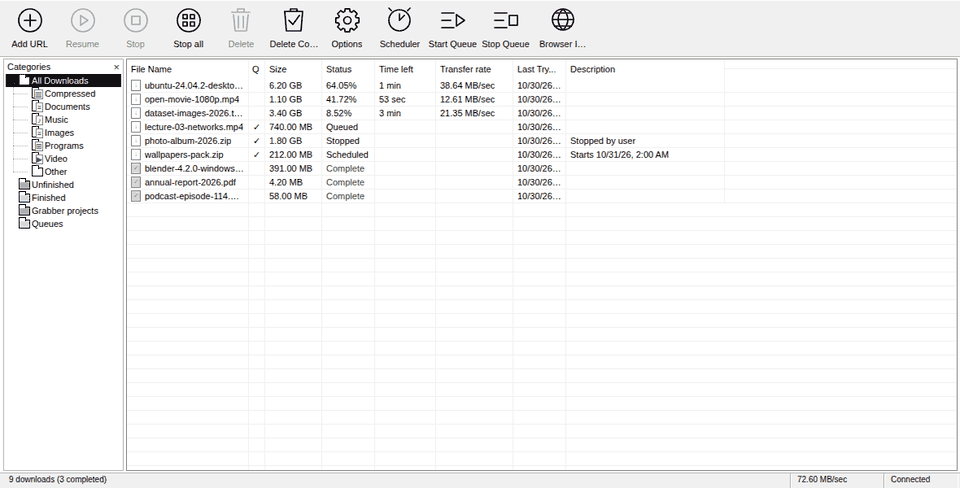
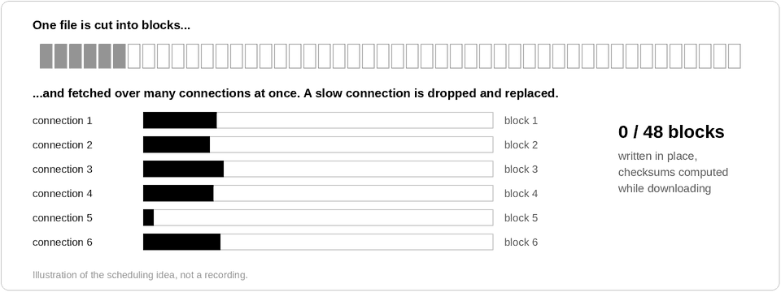
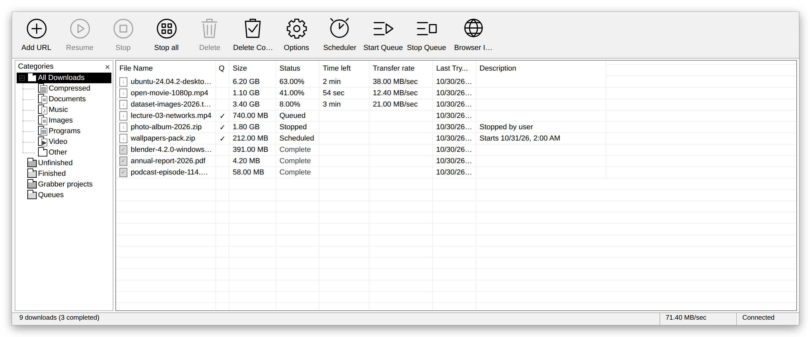
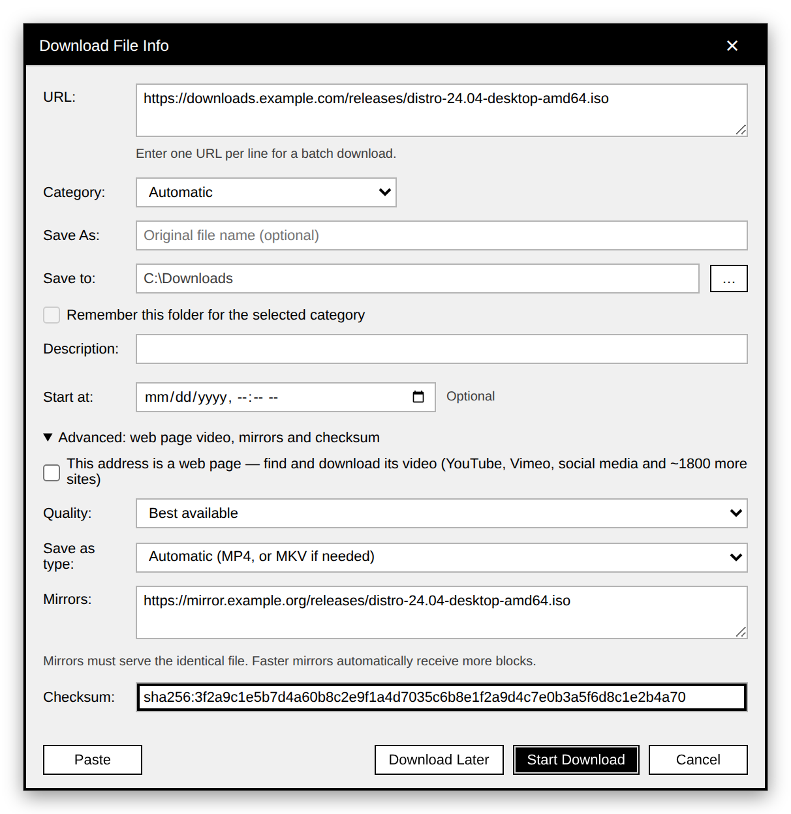
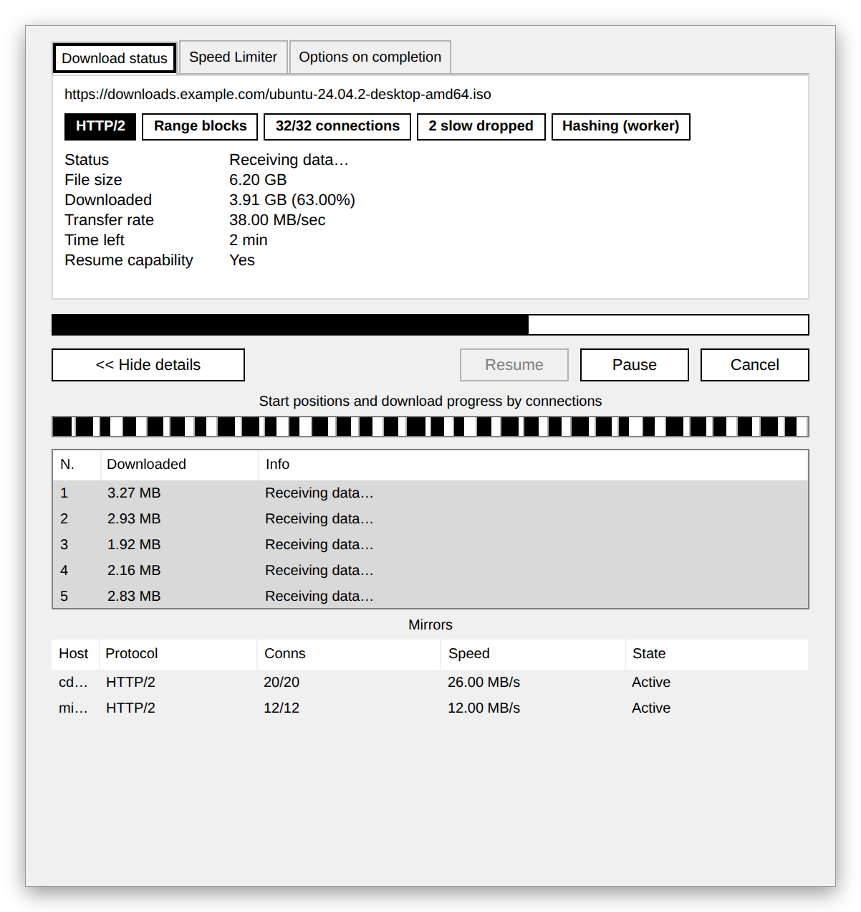

<p align="center">
  
</p>

<h3 align="center">A fast, free, open-source download manager for Windows, macOS and Linux.</h3>

<p align="center">
  Splits big files into blocks, downloads them over many connections at once, takes over your browser's downloads,<br>
  and pulls the video out of almost any web page. No ads, no accounts, no telemetry.
</p>

<p align="center">
  <a href="https://github.com/zelvior/zdm/releases/latest"></a>
</p>

<p align="center">
  <a href="https://github.com/zelvior/zdm/releases"></a>
  <a href="https://github.com/zelvior/zdm/releases"></a>
  <a href="https://github.com/zelvior/zdm/actions/workflows/test.yml"></a>
  <a href="LICENSE"></a>
  
  
  <a href="https://github.com/zelvior/zdm/stargazers"></a>
</p>

<p align="center">
  <a href="#-install">Install</a> &nbsp;·&nbsp;
  <a href="#-features">Features</a> &nbsp;·&nbsp;
  <a href="#-how-it-works">How it works</a> &nbsp;·&nbsp;
  <a href="#-screenshots">Screenshots</a> &nbsp;·&nbsp;
  <a href="#-browser-integration">Browser integration</a> &nbsp;·&nbsp;
  <a href="#-documentation">Docs</a> &nbsp;·&nbsp;
  <a href="#-contributing">Contribute</a>
</p>

<p align="center">
  
  <br>
  <sub>The real interface with sample downloads: add a link, and the details window shows the protocol, the connections and the progress.</sub>
</p>

---

## ⚡ Highlights

| | | |
|---|---|---|
| **Fast**<br>Up to 64 parallel connections per file, HTTP/1.1 and HTTP/2 with multiplexing | **Resilient**<br>Resume after pause, crash or restart, with byte-exact results | **Adaptive**<br>Fast connections get bigger blocks, slow ones are dropped and replaced |
| **Polite**<br>Backs off when a server answers 429 / 503, honours `Retry-After`, then recovers slowly | **Verified**<br>SHA-256 and MD5 are computed while downloading. A wrong checksum discards the file | **Any video page**<br>`yt-dlp` and `ffmpeg` find and merge the best streams, up to 4K |

## 📥 Install

| System | Download from the [Releases](https://github.com/zelvior/zdm/releases/latest) page |
|---|---|
| **Windows 10 / 11**, 64-bit | `ZDM-Setup.exe` |
| **Windows 7 / 8 / 8.1**, or 32-bit Windows | `ZDM-32bit.exe` / `ZDM-64bit.exe` |
| **macOS**, Apple Silicon / Intel | `ZDM-mac-arm64.dmg` / `ZDM-mac-x64.dmg` |
| **Older macOS** (10.13 and newer, Intel) | `ZDM-legacy-mac-x64.dmg` |
| **Linux**, 64-bit Intel/AMD and ARM64 | `ZDM-linux-*.AppImage`, `.deb` or `.rpm` |
| **Older Linux**, and 32-bit Linux (experimental) | `ZDM-legacy-linux-*` |

> [!NOTE]
> The installers and apps are **not code-signed**, so Windows SmartScreen and macOS Gatekeeper warn the first time. Verify the SHA-256
> file on the release page before running. Closing the window keeps ZDM in the system tray (switchable in Options).

Step-by-step instructions for every system, including connecting the browser extension: **[docs/INSTALL.md](docs/INSTALL.md)**.
What the *legacy* builds can and cannot cover: **[docs/LEGACY.md](docs/LEGACY.md)**.

## ✨ Features

| | |
|---|---|
| **Fast transfers** | Up to 64 parallel connections per file, HTTP/1.1 and HTTP/2 (ALPN) with multiplexing, one pre-sized file written directly in place, resume after pause, crash or restart |
| **Built for huge files** | Block size grows with the file: 2–4 MB for small files, up to 64 MB for files over 128 GiB. A 500 GB download needs about 8,000 requests instead of about 125,000 |
| **Adaptive** | Fast connections get larger blocks, slow ones are dropped and replaced, faster mirrors receive more blocks, idle connections duplicate the last stragglers |
| **Polite to servers** | HTTP 429 / 503 halve that server's connections, honour `Retry-After`, move to one multiplexed HTTP/2 session, then recover slowly |
| **Integrity** | SHA-256 and MD5 are computed in a worker thread while downloading. Enter a checksum and a mismatch discards the file |
| **Any file** | Every file type, categorised (Video, Audio, Images, Archives, Documents, Programs, Other). Missing extensions are filled in from Content-Type |
| **Any video page** | `yt-dlp` and `ffmpeg` find and merge the best streams: choose quality (up to 4K, 1080p, 720p, 480p, audio only) and container (MP4, MKV, WebM, MP3, M4A, FLAC, WAV). HLS and DASH (`.mpd`) manifests are supported |
| **Browser takeover** | The Chrome / Edge / Firefox extension sends every browser download to ZDM. If ZDM is not running, the browser keeps the download |
| **Clipboard links** | Copy a download or video link and ZDM offers to add it |
| **Queue and schedule** | Queue downloads, start them later, set a speed limit, a connection count and a memory budget |
| **Live indicators** | Download details show the protocol (HTTP/2 or HTTP/1.1), range blocks, multiplexing, connections in use, throttling, hashing and checksum status |

DRM-protected streams (Widevine, PlayReady, FairPlay) are refused. ZDM does not and will not bypass DRM.

## 🔬 How it works

<p align="center">
  
  <br>
  <sub>An illustration of the scheduling idea, not a recording of ZDM.</sub>
</p>

1. **Blocks.** The file is cut into blocks (2–4 MB, growing with the file) and every byte is covered exactly once.
2. **Connections.** Up to 64 connections fetch blocks in parallel, over HTTP/2 multiplexing where the server supports it. Each block is written straight to its place in one pre-sized file, so there is no merge step at the end.
3. **Adaptation.** A connection that is too slow is dropped mid-block and its block is finished by faster ones. With several mirrors, the faster mirror receives more blocks. Near the end, idle connections duplicate the last stragglers and the first copy wins.
4. **Courtesy.** On HTTP 429 or 503 ZDM halves that server's connections, waits as the server asks, then creeps back up.
5. **Integrity.** Checksums are computed on the fly in a worker thread. A mismatch against a checksum you entered discards the file instead of keeping a corrupt one.

More detail on the engine: **[docs/PERFORMANCE.md](docs/PERFORMANCE.md)**.

## 📷 Screenshots

These are ZDM's real interface with sample downloads.

<p align="center">
  
</p>

<table>
  <tr>
    <td align="center" width="50%"></td>
    <td align="center" width="50%"></td>
  </tr>
  <tr>
    <td align="center"><sub><b>Add URL</b>: batch links, mirrors, a checksum, or a web page to extract its video</sub></td>
    <td align="center"><sub><b>Details</b>: protocol, connections, per-connection progress and mirrors</sub></td>
  </tr>
</table>

## 🌐 Browser integration

The extension for **Chrome, Edge and Firefox** hands your browser's downloads to ZDM and adds a *Download this page's video* button.

- Every `http(s)` download is taken over by default, and the browser's own copy is cancelled only after ZDM accepts it.
- If ZDM is not running, or refuses the download, **the browser keeps it**.
- `blob:`, `data:` and `file:` downloads, and sites or file types you exclude, are left alone.
- The link between the extension and the app is a local, authenticated channel; web pages cannot read the status or control downloads.

Setup takes a minute: **[docs/INSTALL.md](docs/INSTALL.md#connect-your-browser)**.

## 🚀 Use it

- **Add URL:** paste one or many links. Under *Advanced* you can add mirrors, a checksum, or tick *This address is a web page* to extract its video.
- **From the browser:** click a download link, or use the extension's *Download this page's video* button.
- **Pause, resume, queue, schedule:** from the toolbar. Speed limit, connection count, memory budget and the rest are in **Options**.

## 🔒 Privacy and safety

- **No ads, no accounts, no telemetry.**
- Request credentials (cookies and headers the browser hands over) are kept out of the download history and the interface, and cannot cross tabs or URLs.
- DRM is refused, not bypassed.
- Found a security problem? Please read **[SECURITY.md](SECURITY.md)**.

## 📚 Documentation

| | |
|---|---|
| [docs/INSTALL.md](docs/INSTALL.md) | Install on Windows, macOS and Linux, connect the browser, uninstall |
| [docs/LEGACY.md](docs/LEGACY.md) | Older systems and 32-bit builds: what is covered and what is not |
| [docs/PERFORMANCE.md](docs/PERFORMANCE.md) | How the transfer engine downloads fast |
| [docs/RELEASING.md](docs/RELEASING.md) | How a release is built and published |
| [docs/BROWSER-DISTRIBUTION.md](docs/BROWSER-DISTRIBUTION.md) | How the extension is loaded today and how it could be distributed |
| [docs/CONTRIBUTOR-START-HERE.md](docs/CONTRIBUTOR-START-HERE.md) | A map of the code for new contributors |

## 🔧 Build from source

```sh
npm ci
npm test
npm start                     # run the app
npm run dist                  # Windows: NSIS installer -> release/ZDM-Setup.exe
npm run dist:mac -- --arm64   # macOS (or --x64): .dmg and .zip -> release/
npm run dist:linux -- --x64   # Linux (or --arm64): .AppImage, .deb, .rpm -> release/
```

Requires Node.js 22. Build each package on its own operating system (Windows installer on Windows, `.dmg` on macOS, Linux packages on
Linux). Before `dist:mac` / `dist:linux`, fetch yt-dlp with `node scripts/fetch-ytdlp.mjs vendor mac` (or `linux-x64`, `linux-arm64`).
The 32-bit and older-system track lives in [`legacy/`](legacy/). Release steps: [docs/RELEASING.md](docs/RELEASING.md).

<details>
<summary><b>Project layout</b></summary>

<br>

| Folder | Contents |
|---|---|
| `core/` | Download engine: scheduler, block buffers, write queue, HTTP/1.1 + HTTP/2 transport, DNS cache, hashing, HLS, yt-dlp / ffmpeg extraction |
| `desktop/` | Electron main process, tray, About window, clipboard monitor, browser registration |
| `renderer/` | The user interface |
| `extension/` | Browser extension (Chrome, Edge, Firefox) |
| `integration/` | Native messaging host that links the extension to the app |
| `legacy/` | Build track for older systems and 32-bit (Windows 7/8, older macOS, older and 32-bit Linux) |
| `scripts/` | Build helpers (yt-dlp download, icon and README image generators) |
| `tests/` | Engine tests (extension and integration tests sit beside their code) |
| `docs/` | Documentation, plus `branding/` (logos) and `media/` (README images) |

</details>

## 🤝 Contributing

Bug reports, ideas and pull requests are welcome. Start with **[CONTRIBUTING.md](CONTRIBUTING.md)**; it explains how to run the tests and how to
regenerate the icons and the images in this README. If ZDM is useful to you, a ⭐ helps other people find it.

## 🙏 Built with

[Electron](https://www.electronjs.org/) · [yt-dlp](https://github.com/yt-dlp/yt-dlp) · [FFmpeg](https://ffmpeg.org/) ·
[googlevideo](https://github.com/LuanRT/GoogleVideo). Full list and licenses: [THIRD-PARTY.md](THIRD-PARTY.md).

## 📄 License

[Apache License 2.0](LICENSE). See also [NOTICE](NOTICE) and [THIRD-PARTY.md](THIRD-PARTY.md).
<br>Made by **Zelvior**.
